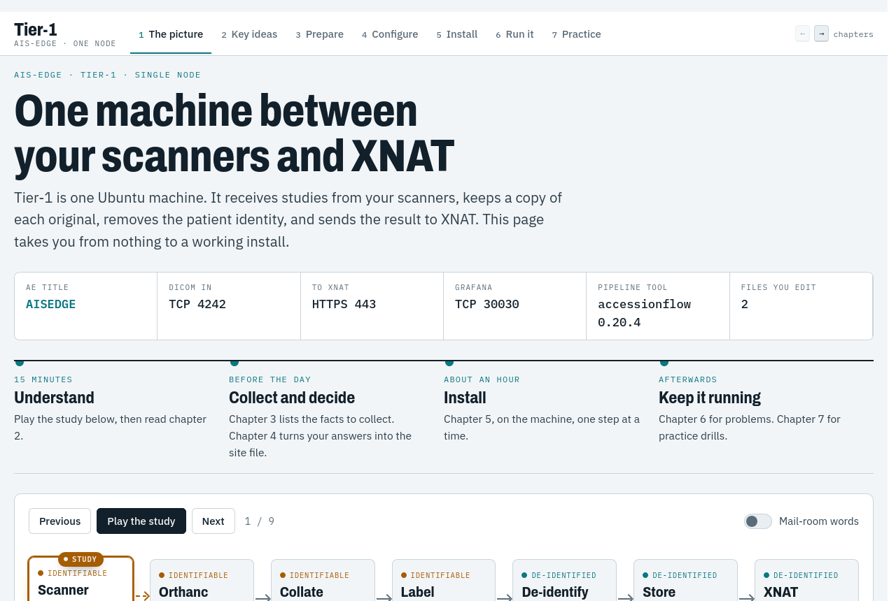
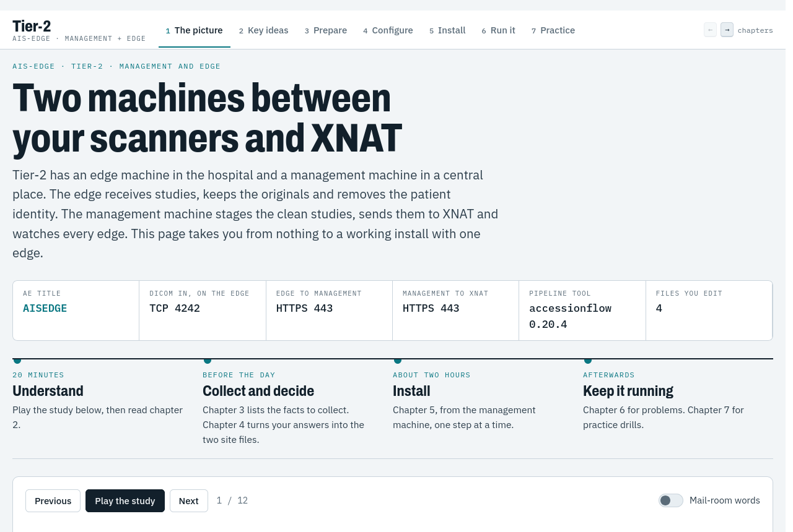

# Interactive walkthroughs

Two pages that take a newcomer from nothing to a working install. Each page
shows the path of one study, explains the words you need, turns your answers
into the site files, and gives every install step with its check.

| Page | What it installs | Branch | Open |
|---|---|---|---|
| **Tier-1** | One machine between the scanners and XNAT | `tier-1-solution` | [in a browser](https://australian-imaging-service.github.io/ais-edge/tier-1.html) · [file](tier-1.html) |
| **Tier-2** | An edge machine in the hospital and a central management machine | `main` | [in a browser](https://australian-imaging-service.github.io/ais-edge/tier-2.html) · [file](tier-2.html) |

[](https://australian-imaging-service.github.io/ais-edge/tier-1.html)

[](https://australian-imaging-service.github.io/ais-edge/tier-2.html)

## How to open a page

GitHub shows an `.html` file as source text. It does not run it, here or in
a README. Use one of these two ways.

**In a browser, from GitHub Pages.** Use the "in a browser" links in the
table. They work when GitHub Pages is on for this repository (see
[How the pages are published](#how-the-pages-are-published)).

**From a clone.** Each page is one file. It needs no build and no server.

```bash
git clone https://github.com/Australian-Imaging-Service/ais-edge.git
xdg-open ais-edge/docs/interactive/tier-1.html     # Linux
open ais-edge/docs/interactive/tier-1.html         # macOS
```

On a machine with no desktop, copy the file to your own computer and open it
there. A page loads three fonts from Google Fonts when it is online. With no
network it uses the fonts of your system and works the same.

## What is on a page

| Chapter | What you get |
|---|---|
| 1 The picture | The path of one study, stage by stage. Select a stage to see what it does, where its data is, and the command that shows its log |
| 2 Key ideas | The words you need, and the three facts that surprise people |
| 3 Prepare | The facts to collect before the day, as a checklist |
| 4 Configure | Questions with plain answers. The page writes the site file, the data policy and the commands for the secrets file |
| 5 Install | Each step, its command, and how you know that it worked |
| 6 Run it | Symptoms, their causes and the fix |
| 7 Practice | Drills to do before the real install |

What you type stays in your browser. A page sends nothing to a server, and it
has no field for a password: the commands that it writes ask for each secret
on your terminal.

## Names on these pages

The pages name the pipeline stages as
[accessionflow](https://github.com/Australian-Imaging-Service/accessionflow)
does: collate, label, de-identify and store. The pods, log labels, folders
and settings keys of this repository keep older names (`group`, `assign`,
`upload`). A page shows an older name only where a command or a file needs
it, and says so.

## How the pages are published

`.github/workflows/pages.yml` publishes this folder to GitHub Pages after each
change to it on `main`. A repository admin must switch GitHub Pages on one
time: **Settings → Pages → Source: GitHub Actions**. While Pages is off, the
workflow publishes nothing and ends without an error.

The site is public, as this repository is. Put no secret and no detail of a
real site in this folder.

## How to keep a page correct

Each page states facts about one branch: commands, file names, alert names,
default values and the pinned accessionflow version. When a change to the
charts, the scripts or the docs makes one of those facts wrong, correct the
page in the same pull request. A page is plain HTML, CSS and JavaScript in one
file, and its text is not minified.

| Page | Follows | Checked against |
|---|---|---|
| `tier-1.html` | `tier-1-solution` | commit `8ebb700`, accessionflow 0.20.4 |
| `tier-2.html` | `main` | commit `960cf0d`, accessionflow 0.20.4 |
